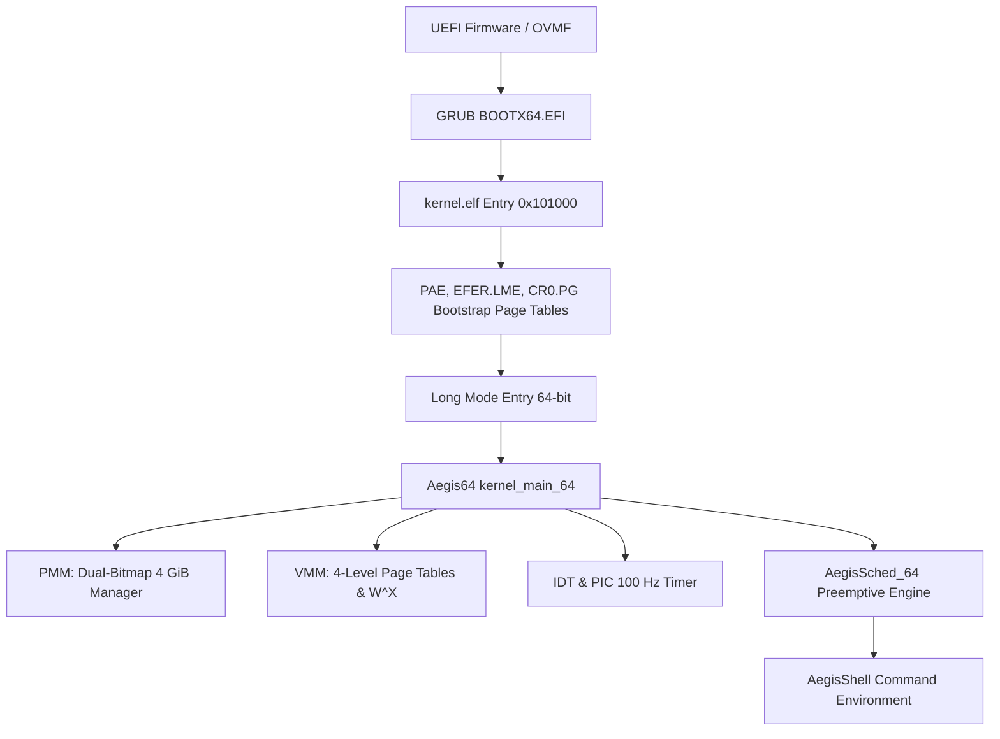

# Aegis64 Architecture

## 1. System Overview

Aegis64 is a monolithic, 64-bit native operating system kernel developed for x86-64 hardware.

## 2. Core Protection Boundaries

- **Privilege Levels:**
  - Kernel core, scheduler, and memory management execute in **Ring 0**.
  - Future application bundles execute in **Ring 3** with narrow syscall interfaces.
- **Memory Protection (W^X):**
  - Code sections (`.text`, `.boot`) are mapped `Read + Execute` (No Write).
  - Data, BSS, and stacks are mapped `Read + Write` with the No-Execute (`NX`) bit enforced.
  - Page table modifications trigger `invlpg` invalidation.
- **Hardware Isolation:**
  - Interrupt vectors 0..31 are dedicated to CPU exceptions with full register dumping and CR2 decoding.
  - Hardware interrupts are mapped cleanly to IRQ 32..47 via the 8259 PIC.

## 3. Virtual File System (VFS) & Storage Architecture

Aegis64 implements a hierarchical Virtual File System (`src/fs/vfs.rs`) multiplexing multiple storage drivers:
- `/` -> PurpleFS v2 journaled persistent storage on GPT block devices (ATA, AHCI SATA, NVMe PCIe).
- `/dev` -> DevFS providing character/block device interfaces (`/dev/null`, `/dev/zero`, `/dev/console`, `/dev/storage`).
- `/proc` -> ProcFS exposing dynamic kernel state (`/proc/version`, `/proc/meminfo`, `/proc/uptime`, `/proc/cpuinfo`, `/proc/tasks`).
- `/tmp` -> Volatile high-speed RAM disk (TmpFS).

## 4. Pure Rust TCP/IP Network Protocol Stack

A native L2/L3/L4 protocol stack (`src/net/`) is integrated directly with hardware NIC drivers:
- **Layer 2:** Ethernet II framing (`eth.rs`) and dynamic ARP resolution cache (`arp.rs`).
- **Layer 3:** IPv4 packet framing with 16-bit Internet Checksum validation (`ipv4.rs`) and ICMP echo responder (`icmp.rs`).
- **Layer 4:** UDP datagram multiplexing (`udp.rs`) and TCP segment processing (`tcp.rs`).
- **Hardware Binding:** DMA descriptor ring interfacing with Intel 82540EM (`e1000.rs`) and Realtek RTL8139 (`rtl8139.rs`).

## 5. Per-Process Virtual Address Spaces

Tasks support independent 4-level PML4 page tables (`src/kernel/task.rs`):
- `cr3` field in `Task` structure holding the physical address of the task's PML4 root.
- Higher-half kernel mapping (`0xFFFF_8000_0000_0000..`) mirrored into all task page tables.
- Hardware `switch_context` reloads `%cr3` dynamically during preemptive task switches.

## 6. Expressive Shell Grammar

AegisShell 2.0 (`src/kernel/shell.rs`) features natural English command syntax (`copy <source> to <destination>`, `move <source> to <destination>`, `delete <file>`, `show <category>`, `ping to <ip>`, `remount volume as <mode>`, etc.) alongside classic command shortcuts.
