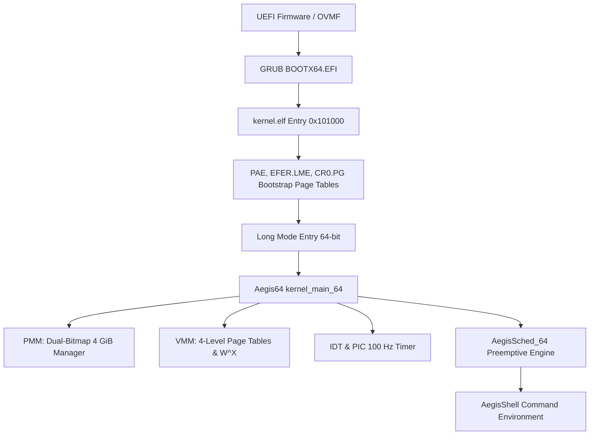

# Aegis64 Architecture

## 1. System Overview

Aegis64 is a monolithic, 64-bit native operating system kernel developed for x86-64 hardware.

## 2. Core Protection Boundaries

- **Privilege Levels:**
  - Kernel core, scheduler, and memory management execute in **Ring 0**.
  - Future application bundles execute in **Ring 3** with narrow syscall interfaces.
- **Memory Protection (W^X):**
  - Code sections (`.text`, `.boot`) are mapped `Read + Execute` (No Write).
  - Data, BSS, and stacks are mapped `Read + Write` with the No-Execute (`NX`) bit enforced.
  - Page table modifications trigger `invlpg` invalidation.
- **Hardware Isolation:**
  - Interrupt vectors 0..31 are dedicated to CPU exceptions with full register dumping and CR2 decoding.
  - Hardware interrupts are mapped cleanly to IRQ 32..47 via the 8259 PIC.
