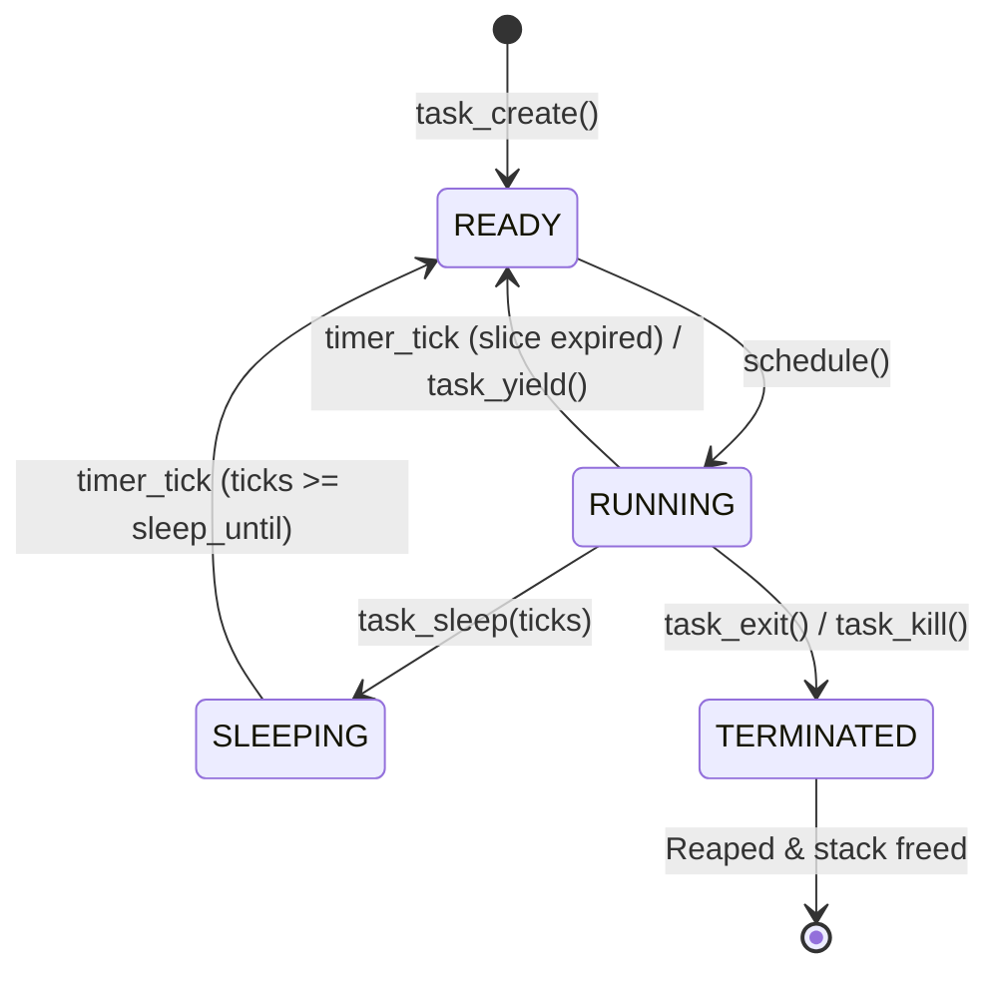

# Scheduler Design: AegisSched_64 / PurpleSched

## 1. Overview

**AegisSched_64** is a priority-aware round-robin preemptive scheduler designed for the Aegis64 kernel.

## 2. Priority Tiers and Time Slices

| Priority Level | Time Slice (Ticks) | Execution Duration (@ 100 Hz) |
|---|---|---|
| `PRIORITY_IDLE` | 1 tick | 10 ms |
| `PRIORITY_LOW` | 2 ticks | 20 ms |
| `PRIORITY_NORMAL` | 5 ticks | 50 ms |
| `PRIORITY_HIGH` | 10 ticks | 100 ms |

## 3. Task Lifecycle & States

## 4. Context Switch & ABI Preservation

- **Calling Convention:** System V AMD64 ABI.
- **Saved Registers:** Callee-saved registers (`rflags`, `rbx`, `rbp`, `r12`, `r13`, `r14`, `r15`, and `rsp`).
- **Trampoline (`task_trampoline`):**
  - Pops task argument into `%rdi` and entry function into `%rax`.
  - Enables interrupts (`sti`).
  - Calls entry function `call *%rax`.
  - On return, cleanly terminates task via `task_exit()`.
- **Task Stack:** 16 KiB per thread (4 physical frames), allocated through PMM.

## 5. SMP Status & Conservatism

- The current implementation operates as a verified uniprocessor (UP) multitasking kernel.
- In accordance with the project guidelines, multicore SMP is treated as experimental and unverified until AP bootstrap, APIC timer routing, per-CPU run queues, and cross-CPU TLB shootdowns are fully implemented and verified via multi-vCPU QEMU test assertions.
