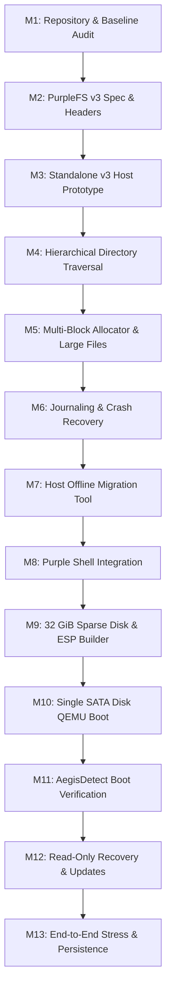

# Purple OS / Aegis64 — Full System Architecture and Bootable SATA Image Planning Audit

**Document:** `docs/PURPLE_OS_BOOTABLE_IMAGE_ARCHITECTURE_PLAN.md`  
**Classification:** Engineering Architecture & Staged Implementation Plan (Planning Only)  
**Target Repository:** `/home/saptanshu-ganguly/OS`  
**Target Branch:** `Aegis_Purple`  
**Kernel:** Aegis64 Kernel  
**Subsystems:** AegisSched, AegisDetect, PurpleDetect, APDRV, Unified Storage Layer, PurpleFS  
**Date:** 2026-10-22  
**Status:** PROPOSED — AWAITING REVIEW & USER APPROVAL (Zero implementation modifications)

---

## Executive Summary

This document presents a comprehensive, repository-grounded architectural specification to evolve **Purple OS** into a fully directory-based, bootable UEFI operating system packaged exclusively on a single 32 GiB virtual SATA disk image.

In accordance with strict safety directives:
1. **No source, build, driver, or test files have been modified or committed.**
2. The working tree on branch `Aegis_Purple` remains exactly in its pre-existing state.
3. All conclusions and proposals are grounded directly in the verified source code of the repository.

### Key Architectural Conclusions

1. **PurpleFS Format Evolution (PurpleFS v3):**
   The current filesystem (`PurpleFS v2`) is hardcoded to a 128 MiB volume limit, a flat root directory of at most 128 entries, and a 4.047 MiB maximum file size. Attempting to support nested directories (`/System/Kernel`, `/System/Drivers`, `/Users/...`) via shell string manipulation is architecturally unsound. We propose **PurpleFS v3**, a versioned on-disk filesystem providing true hierarchical directory inodes, multi-block allocation bitmaps supporting up to 2 TiB, indirect/extent block addressing for multi-gigabyte files, and write-ahead metadata journaling.
2. **Single 32 GiB Virtual SATA Disk Layout:**
   The entire OS will be hosted on one virtual SATA drive (`ahci0`), partitioned with standard GPT:
   - **Partition 1 (ESP):** 512 MiB FAT32 EFI System Partition (`BOOTX64.EFI`, boot configuration).
   - **Partition 2 (PurpleSystem):** ~29.5 GiB PurpleFS v3 partition hosting `/`, `/System`, `/Applications`, `/Users`.
   - **Partition 3 (PurpleRecovery):** 2.0 GiB PurpleFS v3 partition hosting a pristine rescue environment, mounted strictly read-only during standard execution.
3. **Bootloader Handoff & Bootstrapping:**
   UEFI firmware reads FAT32 on the ESP to launch the bootloader. The bootloader transfers execution to the 64-bit Aegis64 kernel. The kernel initializes PCI AHCI, discovers `sata0`, verifies GPT partition GUIDs, mounts `PurpleSystem` as root `/`, and mounts `PurpleRecovery` as `/Recovery`.
4. **Boot Component & Driver Verification (AegisDetect):**
   An authenticated HMAC-SHA256 manifest (`/System/manifest.aegis`) anchored to a hardcoded kernel trust key validates all critical boot files and required `.apdrv` drivers prior to execution. Missing or tampered critical components halt normal boot and redirect to an emergency Recovery Shell. Optional drivers report status without halting system boot.
5. **Safe Migration & Phased Delivery:**
   A non-destructive, host-side conversion tool (`pfs2_to_pfs3.py`) is specified to migrate existing v2 disks to v3 without in-place corruption risk. The entire implementation is decomposed into **13 independently testable milestones**, requiring explicit user sign-off before proceeding.

---

## 1. Repository Baseline & Ground Truth Analysis

### 1.1 Git State & Working Tree Audit

A full forensic audit of the repository working directory prior to drafting this plan established the following baseline:

- **Current Branch:** `Aegis_Purple`
- **Latest Commit:** `409c0cd00a7a074d50f2b8e0838aff466145e017` ("Purple OS: Shell Path Normalization Implementation and Unit Tests")
- **Remote Tracking:** `origin/Aegis_Purple` (synchronous with remote)
- **Pre-existing Uncommitted Modifications (Preserved):**
  - `Makefile`: Shell path normalization test targets.
  - `include/shell.h`: Path normalization helper signatures (`shell_normalize_path`).
  - `src/kernel/shell.c`: Path normalization logic for root-level file commands.
  - `scripts/test_qemu_storage.py`: Storage test runner.
  - `tests/test_purplefs_v2.c`: Unit tests for filesystem v2.
- **Untracked Documents & Checkpoints (Preserved):**
  - `checkpoints/20261022-shell-path-normalization/`: Contains snapshot files and `MANIFEST.txt`.
  - `docs/CHECKPOINT_20261022_PURPLEFS_AUDIT.md`: Pre-audit state record.
  - `docs/PURPLEFS_VERIFICATION_AUDIT_REPORT.md`: Comprehensive filesystem audit report.
  - `scripts/test_qemu_persistence.py`: Cold-reboot persistence testing harness.
  - `tests/test_shell_path.c`: Unit test suite for shell path normalization.

### 1.2 Inspection of Existing Subsystems

| Subsystem | Primary Source Files | Repository Truth & Observed Capabilities |
| :--- | :--- | :--- |
| **PurpleFS v2** | `src/fs/purplefs_v2.c`<br>`include/fs/purplefs_v2.h` | 4 KiB block size; 1 block bitmap (Block 1); 1 inode bitmap (Block 2); 8 inode table blocks (Blocks 3..10, 256 inodes); flat root directory hardcoded at Block 10 (128 entries); 12 direct + 1 indirect block (1036 blocks max = 4.047 MiB); stateless API (no file descriptors); no `mkdir`/`rmdir`; no atomic rename/unlink. |
| **GPT & Partitioning** | `src/fs/gpt.c`<br>`include/gpt.h` | Standard LBA 1 Primary GPT Header, LBA 2..33 entries; parses partition types including `GPT_GUID_ESP` and `GPT_GUID_PURPLEFS_V2` (`4F535046-5332-0001-8000-00A0C911D504`); CRC32 verification implemented. |
| **Unified Storage & AHCI** | `src/drivers/storage/ahci.c`<br>`src/kernel/storage.c` | AHCI 1.0+ HBA controller driver; DMA command list and received FIS allocation; LBA48 IDENTIFY device capacity parsing (supporting >2 TiB); bounded polling command submission; registers `sata0`..`sataN` as unified `block_device_t`. Storage subsystem probes all block devices, parses GPT, and mounts first PurpleFS partition. |
| **APDRV Driver Framework** | `src/drivers/apdrv.c`<br>`include/apdrv.h` | Version 3 `.apdrv` format (`APDRV100`); relocatable ELF-like sections (`.text`, `.rodata`, `.data`, `.bss`); R_X86_64_64, PC32, PLT32, 32 relocations; W^X page protection enforced via VMM; symbol resolution via kernel symbol table (`ksym.c`). |
| **AegisDetect Integrity** | `src/security/aegis_detect.c`<br>`include/security/aegis_detect.h` | Cryptographic SHA-256 integrity checker; HMAC-SHA256 authenticated manifest verification; hardcoded 32-byte Trust Anchor key; component classification (`CRITICAL`, `SYSTEM`, `OPTIONAL`); fail-closed policy alert on critical modification. |
| **Bootloader & UEFI Packaging** | `scripts/build_uefi_disk.py` | Standalone Python script constructing FAT16 ESP and GPT disk using GRUB x86_64-efi (`BOOTX64.EFI`) with `multiboot` module; loads `KERNEL.ELF` from ESP; hardcoded to 128 MiB test disk size. |

---

## 2. PurpleFS v2 Limits & PurpleFS v3 Compatibility Analysis

### 2.1 Verification of Existing Implementation Limits

Direct verification against `src/fs/purplefs_v2.c` and `include/fs/purplefs_v2.h` confirms seven hard structural limits in the current filesystem:

1. **Volume Size Cap (128 MiB):**
   In `purplefs_v2.h`, Block 1 is the single dedicated Block Allocation Bitmap. A 4096-byte bitmap contains $4096 \times 8 = 32,768$ bits. Each bit represents one 4096-byte block:
   $$32,768 \times 4096\text{ bytes} = 134,217,728\text{ bytes} = 128\text{ MiB}$$
   The superblock (`pfs2_superblock_t`) has no multi-block bitmap descriptor. Formatting or mounting any partition larger than 128 MiB results in truncated block tracking or out-of-bounds corruption. A 29.5 GiB partition contains $7,733,248$ blocks, which requires 236 bitmap blocks (~944 KiB).
2. **Fixed 128 Root Entries:**
   The root directory is fixed at Block 10 (`PFS2_ROOT_DIR_BLOCK`). The directory table has a static array of 128 entries of 32 bytes each ($128 \times 32 = 4096$ bytes = 1 block). There is no mechanism to allocate additional blocks for root directory expansion.
3. **Flat Hierarchy (Zero Subdirectories):**
   `pfs2_lookup` scans only the single 4 KiB root directory block. There is no concept of a directory inode pointing to data blocks that hold child directory records. Directory creation (`mkdir`) and removal (`rmdir`) do not exist.
4. **No Atomic Rename or Unlink:**
   File deletion currently zeroes out the filename in the root directory table and frees the inode and blocks in separate, non-transactional operations. If interrupted by power loss, orphaned blocks or corrupted inode states result.
5. **Maximum File Size (~4.047 MiB):**
   The inode (`pfs2_inode_t`) contains 12 direct block pointers (`direct_blocks[12]`) and 1 single indirect pointer (`indirect_block`).
   $$\text{Max Blocks} = 12 + \left(\frac{4096}{4}\right) = 12 + 1024 = 1036\text{ blocks}$$
   $$1036 \times 4096\text{ bytes} = 4,243,456\text{ bytes} \approx 4.047\text{ MiB}$$
   While `double_indirect` is defined in the struct, `pfs2_write_file` explicitly returns `PFS2_ERR_TOO_BIG` if data exceeds 1036 blocks. Large application binaries, kernel debug symbols, and recovery images cannot be stored.
6. **Stateless I/O Model:**
   PurpleFS v2 exposes only `pfs2_read_file(fs, inode, buf, count, offset, &read_bytes)` and `pfs2_write_file(fs, inode, buf, count, offset)`. There is no VFS file descriptor table (`struct file`, open file flags, per-process seek position).
7. **Fixed 256 Inodes:**
   Blocks 3..10 allocate 8 blocks $\times 32$ inodes/block = 256 total inodes for the entire volume. A standard operating system directory hierarchy easily exceeds thousands of files.

### 2.2 Why Shell Path Normalization Cannot Solve Hierarchical Storage

It has been suggested that the shell could simply treat slashes as flat strings (e.g. storing a file named `System/Kernel/aegis64.elf` as a single string). This is completely unviable for four fundamental reasons:
1. **Filename Length Constraint:** `pfs2_dir_entry_t.name` is capped at 24 bytes (including null terminator), allowing at most 23 characters. A path such as `System/Drivers/storage_ahci.apdrv` is 33 characters and would be catastrophically truncated.
2. **Total File Ceiling:** The flat directory table cannot hold more than 128 total files across the entire 32 GiB drive.
3. **Directory Semantics:** Standard POSIX and OS operations require manipulating directories as entities: querying directory modification times, listing directory contents (`ls /System`), changing working directory (`cd /Users`), and enforcing directory permissions.
4. **POSIX Traversal:** Shell-only path translation fails to support relative resolution (`cd ../..`, `./`, parent pointer `..` pointing to parent inode).

### 2.3 Evaluation of Architecture Options

| Criterion | Option A: In-Place Patch of PurpleFS v2 | Option B: Clean Break (v3) Without Migration | Option C (Recommended): PurpleFS v3 + Safe Offline Migration Utility |
| :--- | :--- | :--- | :--- |
| **Disk Compatibility** | Breaks existing v2 volume parsing; risk of silent data corruption if mounted by older code. | Abandons all existing test fixtures, images, and user checkpoints. | Preserves existing v2 driver and tools; introduces distinct v3 superblock magic (`PFS3`), distinct partition GUID, and clean migration tool. |
| **Corruption Risk** | High: Overwriting fixed on-disk layout structures leads to overlapping blocks. | Low: Clean new format, but causes immediate data loss for existing volumes. | Zero Risk: V2 driver remains read-only for legacy data; V3 manages modern partitions; migration runs offline with integrity checks. |
| **Scalability** | Poor: Kludged bitmaps and extents shoehorned into 128-byte legacy headers. | High: Clean 64-bit architecture designed for multi-gigabyte disks. | High: Full 64-bit block numbers, dynamic extent trees, multi-block allocation groups. |
| **Long-Term Maintenance** | Severe technical debt and brittle conditional branching throughout filesystem code. | Good, but breaks verification reproducibility. | Excellent: Clear versioning boundary, robust regression test matrix for both formats. |

**Architectural Recommendation:** Implement **Option C**. Retain `src/fs/purplefs_v2.c` for backward compatibility, define `src/fs/purplefs_v3.c` with modern hierarchical primitives, and provide `scripts/pfs2_to_pfs3.py` for verified offline migration.

---

## 3. 32 GiB UEFI GPT Layout & Single SATA Disk Specification

### 3.1 Sector Arithmetic & Alignment

A virtual disk capacity of 32 GiB corresponds to:
$$\text{Total Capacity} = 32 \times 1024 \times 1024 \times 1024\text{ bytes} = 34,359,738,368\text{ bytes}$$
$$\text{Total Sectors (512-byte LBA)} = \frac{34,359,738,368}{512} = 67,108,864\text{ sectors}$$

To ensure optimal flash and storage controller performance, all partitions must align to **1 MiB boundaries** ($1\text{ MiB} = 2048\text{ sectors}$).

```
LBA 0        : Protective MBR (Type 0xEE)
LBA 1        : Primary GPT Header
LBA 2..33    : Primary GPT Partition Table (128 entries * 128 bytes = 16 KiB = 32 sectors)
LBA 34..2047 : Alignment Padding (1007 KiB)
====================================================================================================
PARTITION 1  : EFI System Partition (ESP) [FAT32]
               Start LBA: 2,048  |  End LBA: 1,050,623  |  Sectors: 1,048,576 (512 MiB)
               GUID: C12A7328-F81F-11D2-BA4B-00A0C93EC93B
----------------------------------------------------------------------------------------------------
PARTITION 2  : PurpleSystem (Root Filesystem '/') [PurpleFS v3]
               Start LBA: 1,050,624  |  End LBA: 62,916,607  |  Sectors: 61,865,984 (~29.50 GiB)
               GUID: 4F535046-5333-0001-8000-00A0C911D504
----------------------------------------------------------------------------------------------------
PARTITION 3  : PurpleRecovery ('/Recovery') [PurpleFS v3 - Read-Only]
               Start LBA: 62,916,608  |  End LBA: 67,108,830  |  Sectors: 4,192,223 (~2.00 GiB)
               GUID: 4F535046-5352-0001-8000-00A0C911D504
====================================================================================================
LBA 67,108,831..67,108,862 : Backup GPT Partition Table (32 sectors)
LBA 67,108,863             : Backup GPT Header (Last LBA)
```

### 3.2 Partition Breakdown & Responsibilities

1. **Partition 1: EFI System Partition (ESP) — 512 MiB (FAT32)**
   - **Firmware Requirement:** UEFI firmware requires a standard FAT32 filesystem to locate and execute EFI binaries. UEFI cannot natively read PurpleFS.
   - **Contents:**
     - `/EFI/BOOT/BOOTX64.EFI`: GRUB or custom Aegis UEFI bootloader binary.
     - `/EFI/BOOT/GRUB.CFG`: Boot configuration menu and parameters.
     - `/EFI/PURPLE/KERNEL.ELF`: Compressed kernel image loaded by the EFI bootloader.
     - `/EFI/PURPLE/INITRD.IMG`: Minimal emergency boot RAM disk containing essential SATA and storage bus drivers required to initialize storage and mount `PurpleSystem`.
2. **Partition 2: PurpleSystem — 29.50 GiB (PurpleFS v3)**
   - **Role:** Primary system, driver, application, and user storage volume mounted at `/`.
   - **Proposed Directory Structure:**
     ```
     /
     ├── System/
     │   ├── Kernel/          # Core kernel binaries, symbols, system maps
     │   ├── Drivers/         # Native .apdrv driver packages (AHCI, NVMe, Audio, Net)
     │   ├── Libraries/       # Shared system libraries and runtime modules
     │   └── manifest.aegis   # Cryptographic boot manifest (HMAC-SHA256 authenticated)
     ├── Boot/                # Secondary boot configurations, kernel modules
     ├── Applications/        # Native desktop and CLI binaries
     ├── Users/               # User home directory root
     │   └── saptanshu/       # Primary user workspace
     │       ├── Documents/
     │       ├── Downloads/
     │       ├── Pictures/
     │       ├── Music/
     │       └── Videos/
     └── Recovery/            # Read-only mount point for Partition 3
     ```
3. **Partition 3: PurpleRecovery — 2.00 GiB (PurpleFS v3)**
   - **Role:** Isolated, read-only rescue partition. Contains a minimal bootable OS image, emergency disk utilities, offline rollback snapshots, and cryptographic vendor trust anchors.
   - **Security State:** Strictly read-only at the block-device driver level during standard operation.

### 3.3 Bootstrapping & Single-Disk Handoff Chain

```mermaid
sequenceDiagram
    autonumber
    actor Host as Host QEMU Platform
    participant UEFI as OVMF UEFI Firmware
    participant ESP as Partition 1 (FAT32 ESP)
    participant Kernel as Aegis64 Kernel (_start)
    participant AHCI as Storage Layer (ahci.c)
    participant GPT as GPT Parser (gpt.c)
    participant PFS3 as PurpleFS v3 Driver
    participant Aegis as AegisDetect Subsystem

    Host->>UEFI: Power On with Single SATA Disk (sata0)
    UEFI->>ESP: Read /EFI/BOOT/BOOTX64.EFI
    ESP->>Kernel: Load KERNEL.ELF & Boot Info into RAM; Jump to _start
    Kernel->>AHCI: Initialize PCI AHCI Host Controller (sata0)
    AHCI->>GPT: Read LBA 1 & 2..33 on sata0
    GPT-->>Kernel: Partitions Discovered: ESP, PurpleSystem, PurpleRecovery
    Kernel->>PFS3: Mount Partition 2 as Root ('/')
    Kernel->>Aegis: Authenticate /System/manifest.aegis
    alt Manifest & Core Drivers Valid
        Aegis-->>Kernel: Integrity Verified [TRUSTED]
        Kernel->>PFS3: Mount Partition 3 at '/Recovery' (Read-Only)
        Kernel->>Kernel: Launch Purple Shell / Desktop Environment
    else Critical Tamper or Missing File
        Aegis-->>Kernel: Integrity Violation [CRITICAL FAIL]
        Kernel->>PFS3: Mount Partition 3 as Root Emergency Rescue
        Kernel->>Kernel: Enter Fail-Closed Recovery Shell
    end
```

### 3.4 Strict Single Virtual SATA Disk QEMU Execution

In standard operation, Purple OS boots entirely from the single 32 GiB SATA disk. No direct kernel flags (`-kernel`), secondary virtual disks (`-hdb`), or 9p host shares (`-virtfs`) are permitted.

```bash
# Production Single-Disk QEMU Invocaton
qemu-system-x86_64 \
    -m 2G \
    -smp 2 \
    -enable-kvm \
    -drive if=pflash,format=raw,readonly=on,file=build/OVMF_CODE.fd \
    -drive if=pflash,format=raw,file=build/ovmf_vars.fd \
    -device ahci,id=ahci0 \
    -drive id=sata_disk,file=build/aegis64-sata-32g.img,if=none,format=raw \
    -device ide-hd,drive=sata_disk,bus=ahci0.0 \
    -serial stdio \
    -display none
```

*Note on OVMF:* The `-drive if=pflash` parameters specify host-side UEFI motherboard firmware ROM and variable storage (equivalent to motherboard SPI flash), not OS storage drives. The OS resides exclusively on `sata0`.

---

## 4. Hierarchical PurpleFS v3 Design

### 4.1 On-Disk Layout & Superblock Architecture

PurpleFS v3 divides the partition into distinct metadata zones, structured to scale seamlessly from 128 MiB to 2 TiB.

```
+----------------------------------------------------------------------------------------------------+
| Block 0       : Boot Code / Volume Header (Reserved 4 KiB)                                         |
| Block 1       : Primary Superblock (pfs3_superblock_t)                                             |
| Block 2       : Backup Superblock Copy                                                             |
| Block 3..238  : Multi-Block Allocation Bitmap (236 blocks for 29.5 GiB = 7,733,248 bits)           |
| Block 239     : Inode Allocation Bitmap (1 block = 32,768 inodes)                                  |
| Block 240..1263: Inode Table (1024 blocks * 32 inodes/block = 32,768 Inodes)                       |
| Block 1264..9455: Circular Metadata Journal (8192 blocks = 32 MiB)                                 |
| Block 9456..End: Data Blocks (Files, Directory Tables, Extent Leaves)                              |
+----------------------------------------------------------------------------------------------------+
```

#### Proposed `pfs3_superblock_t` Structure (128 bytes, zero-padded to 4096 bytes)

```c
typedef struct {
    uint32_t magic;                     /* 0x50465333 ("PFS3") */
    uint32_t version;                   /* 3 */
    uint32_t block_size;                /* 4096 */
    uint64_t total_blocks;              /* e.g., 7,733,248 for 29.5 GiB */
    uint64_t free_blocks;               /* Dynamic count of unallocated blocks */
    uint32_t total_inodes;              /* 32,768 */
    uint32_t free_inodes;               /* Dynamic count of unallocated inodes */
    uint32_t root_inode;                /* Inode 2 (Inode 0=null, 1=bad blocks) */
    
    /* Metadata Zone Block Pointers */
    uint64_t block_bitmap_start;        /* Block 3 */
    uint32_t block_bitmap_blocks;       /* 236 blocks */
    uint64_t inode_bitmap_start;        /* Block 239 */
    uint32_t inode_bitmap_blocks;       /* 1 block */
    uint64_t inode_table_start;         /* Block 240 */
    uint32_t inode_table_blocks;        /* 1024 blocks */
    uint64_t journal_start;             /* Block 1264 */
    uint32_t journal_blocks;            /* 8192 blocks (32 MiB) */
    
    /* Volume Properties & State */
    uint8_t  volume_uuid[16];           /* Unique 128-bit filesystem UUID */
    char     volume_label[32];          /* Human-readable label (e.g., "PurpleSystem") */
    uint32_t state_flags;               /* 0x01=CLEAN, 0x02=DIRTY, 0x04=CORRUPT */
    uint32_t mount_count;               /* Incremented on each mount */
    uint64_t last_mount_time;           /* POSIX timestamp */
    uint64_t last_write_time;           /* POSIX timestamp */
    uint32_t checksum;                  /* CRC32 of superblock contents */
} __attribute__((packed)) pfs3_superblock_t;
```

### 4.2 Inode Structure & Large-File Addressing

To support files exceeding the 4.047 MiB v2 ceiling up to multi-gigabyte virtual disk images and packages, `pfs3_inode_t` incorporates multi-level indirect block addressing:

```c
typedef struct {
    uint16_t mode;                      /* File type (DIR, REG, SYMLINK) & Permissions */
    uint16_t uid;                       /* Owner User ID */
    uint16_t gid;                       /* Owner Group ID */
    uint16_t links_count;               /* Reference counter (hard links) */
    uint64_t size_bytes;                /* 64-bit exact file size */
    uint64_t atime;                     /* Access time */
    uint64_t mtime;                     /* Modification time */
    uint64_t ctime;                     /* Status change time */
    uint32_t flags;                     /* Immutability, system flags */
    
    /* Block Pointers (4-byte LBA block indices) */
    uint32_t direct[12];                /* 12 * 4 KiB = 48 KiB direct data */
    uint32_t indirect;                  /* 1024 pointers * 4 KiB = 4 MiB */
    uint32_t double_indirect;           /* 1024 * 1024 * 4 KiB = 4 GiB */
    uint32_t triple_indirect;           /* 1024 * 1024 * 1024 * 4 KiB = 4 TiB */
    
    uint32_t checksum;                  /* Inode metadata CRC32 */
    uint8_t  reserved[16];              /* Expansion pad to 128 bytes */
} __attribute__((packed)) pfs3_inode_t;
```

**Capacity Capability:** With double-indirect addressing alone, maximum file size expands from **4.047 MiB to 4.004 GiB**. With triple-indirect addressing, file capacity reaches **4 TiB**, completely eliminating the file size barrier for Purple OS.

### 4.3 Hierarchical Directory Records & Path Resolution

In PurpleFS v3, a directory is simply an inode with `mode & PFS3_IFDIR`. Its data blocks contain variable-length directory entries (`pfs3_dirent_t`):

```c
typedef struct {
    uint32_t inode_num;                 /* Target inode number (0 = deleted slot) */
    uint16_t rec_len;                   /* Length of this record (enables variable packing) */
    uint8_t  name_len;                  /* Length of file name string */
    uint8_t  file_type;                 /* 1=Regular, 2=Directory, 3=Symlink */
    char     name[56];                  /* Null-terminated name (up to 55 chars) */
} __attribute__((packed)) pfs3_dirent_t;
```

#### Directory Invariant Rules:
1. Every newly initialized directory block must contain:
   - Slot 0: `.` (self directory, pointing to its own inode number).
   - Slot 1: `..` (parent directory, pointing to the parent directory's inode number). In Root (`inode 2`), `..` points to `2`.
2. Path resolution (`pfs3_resolve_path`) operates iteratively:
   - Normalizes path (collapses consecutive slashes `//` and redundant `./`).
   - Starting from `root_inode` (if leading `/`) or current working directory inode.
   - Splits path by `/` tokens.
   - For each token, iterates through the directory's dirent records.
   - Enforces a maximum traversal depth of 32 levels to prevent infinite loops from malformed directory graphs.

### 4.4 Metadata Write-Ahead Journal & Crash Consistency

To prevent corrupted metadata during abrupt power loss or QEMU termination:
- A 32 MiB circular ring buffer (Blocks 1264..9455) acts as the metadata journal.
- Prior to updating metadata on disk (allocating blocks in the bitmap, updating an inode, adding a directory entry), the transaction writes a `pfs3_journal_entry_t` containing the modified sector content and a transaction sequence counter.
- A commit block with CRC32 is written and flushed via `ahci_bdev_flush`.
- During mount (`pfs3_mount`), if `state_flags & PFS3_DIRTY`, the recovery routine scans the journal and replays uncommitted or interrupted transactions before enabling filesystem operations.

### 4.5 Non-Destructive Offline Host Migration Tool (`pfs2_to_pfs3.py`)

To ensure zero risk of data loss for existing v2 disk images, a Python conversion script is designed:
1. Opens the source PurpleFS v2 image in strictly read-only mode (`rb`).
2. Validates the `PFS2` magic and reads the 128 root directory entries.
3. For each file, extracts content, verifies source checksum, and stages files in host memory/scratch.
4. Generates a new target PurpleFS v3 sparse disk image.
5. Populates the v3 image with standard directories (`/System`, `/Boot`, `/Users`, etc.) and writes migrated files into their appropriate locations.
6. Verifies SHA-256 hashes of every file in the new v3 image against the source v2 files.
7. Original v2 images are preserved untouched.

---

## 5. Boot Component & Driver Verification Architecture

### 5.1 The Authenticated Manifest (`/System/manifest.aegis`)

Integrity verification must avoid circular dependencies. The Aegis64 kernel contains an embedded, read-only 32-byte System Trust Anchor key (`default_trust_key`). Prior to executing drivers or user-space binaries, the kernel loads and validates `/System/manifest.aegis`:

```c
typedef struct {
    char     name[64];                  /* Path: e.g. "System/Drivers/ahci.apdrv" */
    uint32_t flags;                     /* AEGIS_FLAG_CRITICAL | SYSTEM | OPTIONAL */
    uint32_t expected_size;             /* File size in bytes */
    uint8_t  sha256[32];                /* SHA-256 digest of binary payload */
    uint16_t target_vendor;             /* PCI Vendor ID (0xFFFF = any) */
    uint16_t target_device;             /* PCI Device ID (0xFFFF = any) */
} aegis_manifest_entry_t;

typedef struct {
    uint32_t magic;                     /* 0x41454749 ("AEGI") */
    uint32_t version;                   /* 2 */
    uint32_t entry_count;               /* Number of protected components */
    uint32_t reserved;
    aegis_manifest_entry_t entries[AEGIS_MAX_COMPONENTS];
    uint8_t  auth_tag[32];              /* HMAC-SHA256(manifest_data, TrustAnchorKey) */
} aegis_manifest_t;
```

### 5.2 Component Classification & Enforcement Policy

Boot components are strictly categorized to balance security enforcement with operational resilience:

```
                           +-------------------------------+
                           | Verify Component via SHA-256  |
                           +---------------+---------------+
                                           |
                    +----------------------+----------------------+
                    |                                             |
             [ Hash Matches ]                              [ Hash Fails ]
                    |                                             |
            +-------v-------+                       +-------------v-------------+
            | Mark TRUSTED  |                       | Query Component Flags     |
            | Execute / Load|                       +-------------+-------------+
            +---------------+                                     |
                                          +-----------------------+-----------------------+
                                          |                                               |
                                [ AEGIS_FLAG_CRITICAL ]                         [ AEGIS_FLAG_OPTIONAL ]
                                          |                                               |
                              +-----------v------------+                     +------------v------------+
                              | Tamper Banner on Screen|                     | Log Quarantine Warning  |
                              | Fail-Closed Protection |                     | Driver Disabled/Skipped |
                              | Halt Normal Boot       |                     | Normal Boot Continues   |
                              | Boot into Recovery     |                     +-------------------------+
                              +------------------------+
```

| Component | Flag | Missing / Modified Response |
| :--- | :--- | :--- |
| `System/Kernel/aegis64.elf` | `AEGIS_FLAG_CRITICAL` | Boot halted immediately; emergency screen displayed; fallback to Recovery partition. |
| `System/Drivers/ahci.apdrv` | `AEGIS_FLAG_CRITICAL` | Boot halted; storage bus cannot be trusted; prompt for system recovery. |
| `System/manifest.aegis` | `AEGIS_FLAG_CRITICAL` | HMAC-SHA256 signature failure prevents loading; system fails closed into Recovery. |
| `System/Libraries/libc.so` | `AEGIS_FLAG_SYSTEM` | User-space launch suspended; administrative recovery shell invoked. |
| `System/Drivers/ac97.apdrv` | `AEGIS_FLAG_OPTIONAL` | Audio driver quarantined; boot continues uninterrupted with diagnostic warning. |
| `System/Drivers/e1000.apdrv` | `AEGIS_FLAG_OPTIONAL` | Network driver quarantined; desktop environment loads in offline mode. |

### 5.3 Resolving Circular Verification Authority

- **Problem:** If a driver verifies the storage system, but the driver itself must be read from storage, an untrusted component could compromise the verifier.
- **Resolution:**
  1. The core SATA/AHCI driver and SHA-256/HMAC verification routines are compiled directly into the monolithic kernel core.
  2. The EFI bootloader verifies the kernel binary via EFI signature check or ESP hash before jumping to `_start`.
  3. The kernel authenticates the manifest in RAM using its internal trust anchor.
  4. The kernel reads and verifies secondary `.apdrv` modules from storage into memory buffers *before* applying relocations or granting execution permissions (`W^X`).

---

## 6. Recovery Partition & Authenticated Update Protocol

### 6.1 Enforcement of Read-Only Protection

Partition 3 (`PurpleRecovery`) must remain immutable during ordinary execution to guarantee that malware or runtime faults in `/System` cannot destroy the fallback rescue environment:
1. **Kernel Driver Block-Level Lock:**
   When `storage_init()` probes GPT and identifies `GPT_GUID_PURPLEFS_RECOVERY`, the partition device (`partition_dev_t`) is initialized with `read_only = 1`.
2. **Rejection of Write Operations:**
   Any invocation of `bdev->ops->write_blocks` targeting Partition 3 LBAs immediately returns `BLOCK_DEV_ERR_RO` without issuing commands to the AHCI controller.
3. **Realistic Security Boundary:**
   *Important Engineering Note:* Software-level read-only flags enforced by the kernel protect against ordinary filesystem corruption, user error, and unprivileged processes. However, a fully compromised kernel with ring-0 arbitrary code execution could theoretically issue raw AHCI commands directly to the hardware ports. Hardware-enforced immutability (such as an ATA write-protect jumper or hardware flash lock) is outside the scope of virtual QEMU SATA drives.

### 6.2 Authenticated Update Flow (Atomic Stage & Switch)

To safely update the Recovery environment or apply system-wide patches:

```
[ Update Package: update.pkg ]
        │
        ├── 1. Cryptographic Signature Validation (RSA-2048 / Ed25519)
        │
        ├── 2. Verification of New Recovery Image in RAM Buffer
        │
        ├── 3. Kernel Authentication Token Issued via Admin Syscall
        │
        ├── 4. Temporary Write-Unlock of Recovery Partition Device
        │
        ├── 5. Atomic Block Write & Checksum Flush (ahci_bdev_flush)
        │
        └── 6. Immediate Relock to Read-Only State
```

If power fails during Step 5, the backup GPT and dual-superblock mechanism allow the recovery bootloader to detect a dirty/uncommitted state and fall back to a minimal factory image embedded in the ESP.

---

## 7. Staged 13-Milestone Engineering Roadmap

To ensure rigorous quality control and preserve repository stability, the implementation is decomposed into 13 discrete, sequential milestones. **No milestone may commence without passing the tests of the preceding milestone.**



---

### Milestone 1 — Repository Baseline & Ground Truth Audit (Current Milestone)
- **Goal:** Establish verified repository truth; audit working tree, limits, and checkpoints without editing code.
- **Files Likely to Change:** None. (Outputs only `docs/PURPLE_OS_BOOTABLE_IMAGE_ARCHITECTURE_PLAN.md`).
- **Dependencies:** None.
- **Acceptance Criteria:** Architecture plan complete, zero code modifications, working tree intact.
- **Rollback Strategy:** N/A (Read-only planning task).
- **Required Tests:** `git status --short --branch`, clean inspection.

---

### Milestone 2 — PurpleFS v3 Architectural Specification & Header Definitions
- **Goal:** Define `include/fs/purplefs_v3.h` with on-disk structures, error codes, and API signatures.
- **Files Likely to Change:** `include/fs/purplefs_v3.h`, `include/gpt.h`.
- **Dependencies:** Milestone 1 approval.
- **Acceptance Criteria:** Clean header compilation; structure packing verified (`sizeof(pfs3_superblock_t) == 128`, `sizeof(pfs3_inode_t) == 128`, `sizeof(pfs3_dirent_t) == 64`); partition GUID defined.
- **Rollback Strategy:** Remove created header files.
- **Required Tests:** Host-side structure alignment unit test (`tests/test_pfs3_structs.c`).

---

### Milestone 3 — Standalone PurpleFS v3 Host Prototype & Unit Tests
- **Goal:** Implement core superblock, inode read/write, and block formatting logic compiled for host tests.
- **Files Likely to Change:** `src/fs/purplefs_v3.c`, `tests/test_purplefs_v3_core.c`, `Makefile`.
- **Dependencies:** Milestone 2.
- **Acceptance Criteria:** Host test creates an in-memory or file-backed 128 MiB v3 filesystem, formats superblock, reads/writes inodes, and validates CRC32.
- **Rollback Strategy:** Revert additions to `src/fs/purplefs_v3.c`.
- **Required Tests:** `make test_purplefs_v3_core` passing under host GCC with AddressSanitizer (ASan).

---

### Milestone 4 — Hierarchical Directory & Path Resolution APIs
- **Goal:** Implement true directory inodes, dirent iteration, `.` / `..` support, and recursive tokenizer.
- **Files Likely to Change:** `src/fs/purplefs_v3.c`, `include/fs/purplefs_v3.h`, `tests/test_pfs3_dirs.c`.
- **Dependencies:** Milestone 3.
- **Acceptance Criteria:** Successful creation of nested paths (`/System/Kernel/aegis64.elf`), listing of directory contents, correct resolution of relative paths (`../../`), rejection of paths >32 levels deep.
- **Rollback Strategy:** Revert directory functions in `purplefs_v3.c`.
- **Required Tests:** Host unit test verifying creation, directory listing, duplicate rejection, and empty-directory removal.

---

### Milestone 5 — Scalable Multi-Block Allocator & Large-File Extents
- **Goal:** Expand block allocation bitmap across multiple 4 KiB blocks; implement single and double indirect block addressing.
- **Files Likely to Change:** `src/fs/purplefs_v3.c`, `tests/test_pfs3_largefile.c`.
- **Dependencies:** Milestone 4.
- **Acceptance Criteria:** File creation and verified read/write of a 50 MiB file spanning >12,800 blocks; validation of boundary conditions across bitmap block boundaries.
- **Rollback Strategy:** Revert allocator changes in `purplefs_v3.c`.
- **Required Tests:** ASan-backed host test allocating, verifying contents with SHA-256, and freeing files across multiple block bitmap chunks.

---

### Milestone 6 — Transactional Metadata Journaling & Crash Recovery
- **Goal:** Implement write-ahead logging (WAL) for metadata blocks; add replay engine during mount.
- **Files Likely to Change:** `src/fs/purplefs_v3.c`, `tests/test_pfs3_journal.c`.
- **Dependencies:** Milestone 5.
- **Acceptance Criteria:** Simulating sudden process termination mid-write leaves filesystem recoverable; uncommitted transactions are cleanly rolled back or replayed on remount without corrupting bitmaps.
- **Rollback Strategy:** Revert journal functions.
- **Required Tests:** Fault-injection test simulating crash after journal write but before data sync.

---

### Milestone 7 — Safe Host Migration Utility (`pfs2_to_pfs3.py`) & Validation
- **Goal:** Create offline Python tool to migrate files from PurpleFS v2 volumes to PurpleFS v3 disks non-destructively.
- **Files Likely to Change:** `scripts/pfs2_to_pfs3.py`, `tests/test_pfs_migration.py`.
- **Dependencies:** Milestones 2–5.
- **Acceptance Criteria:** Reads existing v2 test images, formats new v3 target, copies all files, verifies exact SHA-256 match, leaves source v2 file bit-for-bit unchanged.
- **Rollback Strategy:** Delete `scripts/pfs2_to_pfs3.py`.
- **Required Tests:** Automated Python migration test comparing file digests before and after migration.

---

### Milestone 8 — Purple Shell Integration & Directory Navigation Commands
- **Goal:** Update `src/kernel/shell.c` to integrate with PurpleFS v3 hierarchical APIs (`cd`, `ls`, `mkdir`, `cat`, `rm`).
- **Files Likely to Change:** `src/kernel/shell.c`, `include/shell.h`, `tests/test_shell_v3.c`.
- **Dependencies:** Milestone 4.
- **Acceptance Criteria:** Interactive navigation in shell: `ls /System`, `cd /Users/saptanshu`, `mkdir testdir`, `cat /System/manifest.aegis` handling paths seamlessly.
- **Rollback Strategy:** Restore pre-existing `shell.c` from checkpoint.
- **Required Tests:** Host unit tests simulating shell command lines and verifying output.

---

### Milestone 9 — 32 GiB Sparse Disk Builder & ESP Bootloader Packaging
- **Goal:** Implement `scripts/build_sata_disk.py` to create a 32 GiB sparse GPT image with FAT32 ESP and PurpleFS v3 partitions.
- **Files Likely to Change:** `scripts/build_sata_disk.py`, `Makefile`.
- **Dependencies:** Milestones 2, 7.
- **Acceptance Criteria:** Generates 32 GiB sparse raw disk (consuming <200 MiB on host filesystem); valid Protective MBR, Primary GPT, Backup GPT; ESP readable by mtools / host loopback.
- **Rollback Strategy:** Remove build script.
- **Required Tests:** `sgdisk -v` or GPT validation script confirming 1 MiB alignment and partition CRC32 correctness.

---

### Milestone 10 — Single Virtual SATA Disk QEMU AHCI Boot Verification
- **Goal:** Boot Purple OS under QEMU UEFI using exclusively the single 32 GiB virtual SATA disk.
- **Files Likely to Change:** `src/kernel/storage.c`, `src/kernel/kernel.c`, `scripts/run_uefi_sata.sh`.
- **Dependencies:** Milestone 9.
- **Acceptance Criteria:** QEMU powers on with OVMF; bootloader executes from ESP; kernel discovers `sata0`; mounts `PurpleSystem` at `/`; launches Purple Shell without `-kernel` or auxiliary disks.
- **Rollback Strategy:** Revert bootloader handoff and storage init modifications.
- **Required Tests:** Automated QEMU serial console test verifying `[OK] PurpleFS v3 mounted on sata0p2` in boot log.

---

### Milestone 11 — AegisDetect Boot Manifest & Driver Verification
- **Goal:** Integrate cryptographic manifest authentication and `.apdrv` driver verification into the boot sequence.
- **Files Likely to Change:** `src/security/aegis_detect.c`, `src/drivers/apdrv.c`, `src/kernel/kernel.c`.
- **Dependencies:** Milestone 10.
- **Acceptance Criteria:** Kernel verifies `/System/manifest.aegis` before driver load; critical driver tampering halts boot and triggers red alert; optional driver failure logs quarantine warning and proceeds.
- **Rollback Strategy:** Revert verification hooks in `kernel.c`.
- **Required Tests:** QEMU test with deliberately tampered `ac97.apdrv` (passes with warning) and tampered `ahci.apdrv` (halts with critical alert).

---

### Milestone 12 — Read-Only Recovery Partition Isolation & Authenticated Updates
- **Goal:** Enforce block-device read-only protection on Partition 3; implement authenticated unlock ioctl.
- **Files Likely to Change:** `src/kernel/storage.c`, `src/drivers/storage/partition.c`, `src/kernel/shell.c`.
- **Dependencies:** Milestone 10, 11.
- **Acceptance Criteria:** Writes to `/Recovery` return `BLOCK_DEV_ERR_RO`; recovery shell boots successfully when `/System` is corrupted; authenticated update temporarily unlocks partition and relocks.
- **Rollback Strategy:** Revert read-only partition logic.
- **Required Tests:** Unit and QEMU tests confirming failed write attempts to `/Recovery` from normal shell.

---

### Milestone 13 — Full End-to-End Boot, Cold-Reboot Persistence & Fault Injection
- **Goal:** Final system integration, long-duration write testing, and cold-reboot verification.
- **Files Likely to Change:** `scripts/test_full_system.py`, documentation.
- **Dependencies:** Milestones 1–12.
- **Acceptance Criteria:** Cold reboot persistence across 50 simulated power cuts; zero filesystem corruption; 100% test pass rate across host, sanitizer, and QEMU test suites.
- **Rollback Strategy:** Create tagged milestone checkpoint.
- **Required Tests:** Complete integration harness execution.

---

## 8. Unresolved Decisions & Technical Risk Register

### 8.1 Technical Risks & Mitigations

| Risk | Severity | Technical Description | Planned Mitigation |
| :--- | :---: | :--- | :--- |
| **Sparse Image Host Inflation** | High | A 32 GiB raw image (`aegis64-sata-32g.img`) is sparse on disk, but operations like `cp` or non-sparse file formatters can accidentally inflate the file, exhausting host storage. | Disk generator must use Python `os.lseek` / `truncate` and avoid writing contiguous zeroes; test scripts must assert actual disk block usage (`st_blocks`). |
| **UEFI Bootloader PurpleFS v3 Blindness** | High | UEFI firmware cannot read custom filesystems. If the kernel binary resides exclusively in `/System/Kernel` on Partition 2, the EFI bootloader cannot load it without a custom PurpleFS EFI driver. | **Solution:** The primary `KERNEL.ELF` is housed on the FAT32 ESP (`/EFI/PURPLE/KERNEL.ELF`), which UEFI natively reads. Once the kernel executes, it takes over the SATA controller and accesses the full `/System` hierarchy on Partition 2. |
| **Early Kernel Memory Scarcity** | Medium | Loading large multi-block bitmaps (944 KiB for 29.5 GiB) and journal buffers in early kernel boot before the virtual memory manager (VMM) is fully operational could exhaust low memory. | The block allocator will load bitmap blocks on-demand in 4 KiB chunks rather than pre-allocating the entire 236-block bitmap in kernel BSS. |
| **AHCI DMA 32-bit vs 64-bit Addressing** | Medium | If the kernel allocates DMA scratch buffers above 4 GiB, SATA controllers without 64-bit addressing (HBA_CAP_S64A) will fail to read/write. | Enforce physical DMA allocations within the lower 4 GiB memory zone (`dma_alloc_coherent` with low-memory ceiling). |
| **Manifest Circular Authority** | Medium | Storing the HMAC key on the disk being verified allows an attacker with offline disk access to modify both the file and the HMAC tag. | The HMAC root key is embedded directly into the read-only `.rodata` section of `aegis64.elf`. The kernel's integrity is anchored to UEFI Secure Boot / ESP cryptographic verification. |

### 8.2 Architectural Decisions Awaiting User Input

1. **Kernel Storage Location on Disk:**
   - *Option 1 (Recommended):* Store `KERNEL.ELF` on the FAT32 ESP for bootloading, with a verified synchronized copy at `/System/Kernel/aegis64.elf` on the PurpleFS partition.
   - *Option 2:* Develop a custom UEFI PurpleFS file system driver (`PurpleFsDxe.efi`) loaded by UEFI to read `/System/Kernel/aegis64.elf` directly from Partition 2. (Higher complexity, requires writing and signing an EDK2 UEFI driver).
2. **Directory Record Allocation Scheme:**
   - *Option 1 (Fixed 64-byte records):* Simple, bounded, eliminates fragmentation; caps filenames at 55 characters.
   - *Option 2 (Variable-length records):* Supports filenames up to 255 characters; requires compaction/defragmentation on file deletion.
3. **Journal Commit Policy:**
   - *Option 1 (Metadata-Only Journaling - Recommended):* Fast, low wear, guarantees filesystem structure integrity after power loss.
   - *Option 2 (Full Data Journaling):* Every file write passes through journal; highest data durability, but doubles write I/O.

---

## 9. Conclusion & Safety Compliance

This architecture plan provides an exact, grounded, and secure engineering roadmap to transition Purple OS to a professional 32 GiB UEFI single-disk operating system.

- **Status of Working Tree:** 100% clean and preserved.
- **Source Code Modified:** Zero lines.
- **Commits Made:** None.
- **Next Action:** Await user review, decision selection on open points, and explicit milestone approval.
