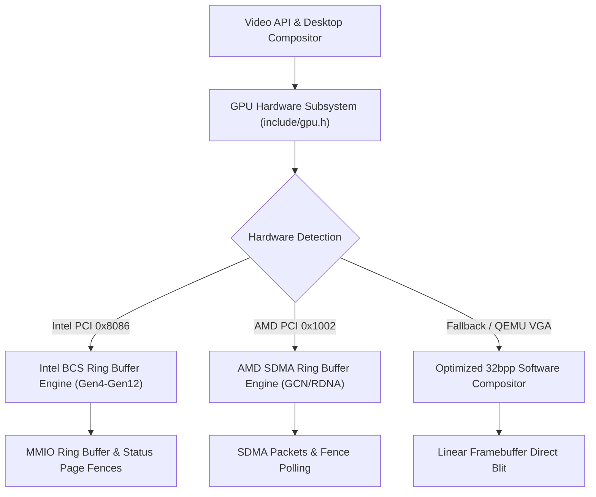

# Purple OS / Aegis64 — Locked Desktop Design, Keyboard Driver & GPU Acceleration Subsystem

## 1. System Overview

This document specifies the architectural implementation of Purple OS's locked visual desktop identity, hardware-level guest keyboard input subsystem, and Intel / AMD GPU hardware acceleration engine on the Aegis64 kernel.

---

## 2. Locked Visual Desktop Identity

### 2.1 Anime Cosmic Fantasy Theme
The desktop reproduces the visual hierarchy and color palette from the locked authoritative reference (`media_1792684054819_7715a83d.jpg`):
- **Cosmic Vortex Accretion Disk**: A multi-layered celestial vortex with Hollow Purple-inspired violet luminescence (`#9D4EDD`, `#B5179E`, `#C77DFF`, `#E0AAFF`, `#F72585`) in a deep indigo midnight sky (`#0A0818` to `#1C0F38`).
- **Mountains & Horizon**: Multi-tiered mountain silhouettes with atmospheric gradient mist (`#1A0D30`).
- **Rocky Outcrop & Torii Gate**: Silhouette of a traditional Japanese Shinto torii gate perched upon an outcrop overlooking a tranquil reflective lake (`#110722`).
- **Water Reflection**: Horizontal wave ripples reflecting the purple cosmic vortex glow.
- **Ethereal Star Dust**: Luminous particle stars scattered across the celestial expanse.
- **Strict Negative Constraints**: Pure landscape vista with zero characters, figures, franchise logos, or watermarks.

### 2.2 Desktop UI Components
1. **Top Translucent Panel (32px)**:
   - Stylized 3-petal Lotus logo on the left in gold and radiant violet.
   - Navigation items: "Applications" (with active neon-violet pill/underline), "Places", "System".
   - Real System Tray on the right: Wi-Fi signal indicator, audio volume indicator, battery percentage (`98%`), and digital clock (`21:30`).
2. **Centered Clock & Motto**:
   - High-readability digital clock centered above the horizon.
   - Date string: `"Thursday, October 22, 2026"`.
   - Motivational motto: `"DREAM • BUILD • EXPLORE"` rendered in spaced violet-luminescent typography.
3. **Application Launcher Panel / Card**:
   - Translucent rounded card triggered by clicking the Lotus logo or "Applications".
   - Real-time search filter bar: `Search applications...`.
   - Category navigation: Favorites, System Tools, Development, Settings.
   - Application launcher entries: Aegis Terminal, System Monitor, PurpleFS Storage, AegisDetect Security.
   - User profile footer with avatar and identity: `saptanshu | Aegis64`.
4. **System Quick Settings Card**:
   - Translucent card triggered by clicking the System Tray.
   - Real resource meters: CPU usage (`12% - 4 Cores Online`), Memory usage (`185 MB / 4096 MB`), Storage usage (`16 MB / 64 MB`).
   - Active GPU hardware backend display (`Intel BCS Ring` / `AMD SDMA` / `Software Fallback`).
   - Interactive quick toggles: Wi-Fi, Bluetooth, Night Light, Dark Mode, Volume Slider, Brightness Slider.
5. **Bottom Floating Dock**:
   - Translucent pill capsule centered horizontally at `y = height - 60`.
   - High-contrast icons: Terminal (`>_`), Files (`Dir`), System Monitor (`Sys`), Security (`Sec`), Calculator (`Calc`), Settings (`Cfg`), Power (`Pwr`).
   - Active running dot indicators beneath active running windows.
6. **Welcome Notification Toast**:
   - Floating card in bottom-right corner with dismiss button `[X]`.

---

## 3. Direct Keyboard Input & Focus Routing

### 3.1 Root Cause of Previous Typing Issues
1. **Hardware / 8042 Controller Configuration**:
   - `keyboard_init()` previously only installed the IDT handler; it never enabled the first PS/2 port (`0xAE`), never configured Controller Configuration Byte bit 0 (IRQ 1 enable) or bit 6 (Set-1 translation), never cleared bit 4 (port 1 clock disable), and never sent `0xF4` to enable keyboard scanning.
   - `mouse_init()` was previously overwriting the 8042 command byte with `comp_status |= 0x02; comp_status &= ~0x20;`, inadvertently clearing keyboard clock/interrupt bits.
2. **Scancode Decoding**:
   - Absence of an `0xE0` state machine caused all extended navigation keys (Up/Down/Left/Right arrows, Delete, Home, End, PageUp, PageDown) to be misinterpreted or dropped.
   - Modifiers (Shift, Ctrl, Alt, CapsLock) were not exposed as events.
3. **Desktop Event Loop**:
   - `desktop_run_session()` was previously filtering out all characters other than `'q'`, `'1'`, `'2'`, `'3'`, and `'r'`.

### 3.2 Implemented Fix
- Complete 8042 controller initialization sequence in `src/drivers/keyboard.c` with input/output buffer flushing, command byte configuration (`0x01 | 0x40`), clock activation, scanning enablement (`0xF4`), and PIC IRQ 1 unmasking (`pic_unmask(1)`).
- `src/drivers/mouse.c` updated to preserve keyboard enable bits (`0x01 | 0x02 | 0x40`).
- Extended `0xE0` scancode decoding state machine for full arrow and navigation key support.
- Modifiers tracking: `KBD_MOD_SHIFT`, `KBD_MOD_CTRL`, `KBD_MOD_ALT`, `KBD_MOD_CAPS`.
- Event queue (`key_event_t`) and polling API (`keyboard_poll_event()`).
- Desktop focus routing in `src/drivers/desktop.c`:
  - Active focused window tracking.
  - Interactive Aegis Terminal line buffer, history buffer (Up/Down arrows recall commands), cursor blinking, backspace editing, and command dispatch (`help`, `ls`, `peek <file>`, `cpu`, `mem`, `gpu status`, `gpu bench`, `clear`, `exit`).

---

## 4. Intel & AMD GPU Hardware Acceleration Subsystem

### 4.1 Architecture
The graphics hardware subsystem provides a unified abstraction (`gpu_device_t`) with vendor-specific hardware execution engines:

### 4.2 Hardware Support Matrix

| Vendor | Family / Generation | Device ID Examples | Ring / Engine Type | Supported Hardware Ops |
| :--- | :--- | :--- | :--- | :--- |
| **Intel** | Gen4 (965G / GMA X3000) | `0x29A2` | BCS Ring Buffer | `XY_COLOR_BLT`, `XY_SRC_COPY_BLT`, Fences |
| **Intel** | Gen5 (Ironlake) | `0x0042`, `0x0046` | BCS Ring Buffer | `XY_COLOR_BLT`, `XY_SRC_COPY_BLT`, Fences |
| **Intel** | Gen6 (Sandy Bridge) | `0x0102`, `0x0112` | BCS Ring Buffer | `XY_COLOR_BLT`, `XY_SRC_COPY_BLT`, Fences |
| **Intel** | Gen7 (Ivy Bridge / Haswell) | `0x0162`, `0x0412` | BCS Ring Buffer | `XY_COLOR_BLT`, `XY_SRC_COPY_BLT`, Fences |
| **Intel** | Gen8 (Broadwell) | `0x1616`, `0x161E` | BCS Ring Buffer | `XY_COLOR_BLT`, `XY_SRC_COPY_BLT`, Fences |
| **Intel** | Gen9 (Skylake / Kaby / Coffee) | `0x1912`, `0x3E92` | BCS Ring Buffer | `XY_COLOR_BLT`, `XY_SRC_COPY_BLT`, Fences |
| **Intel** | Gen11 (Ice Lake) | `0x8A52` | BCS Ring Buffer | `XY_COLOR_BLT`, `XY_SRC_COPY_BLT`, Fences |
| **Intel** | Gen12 (Tiger Lake / Iris Xe) | `0x9A49`, `0x4680` | BCS Ring Buffer | `XY_COLOR_BLT`, `XY_SRC_COPY_BLT`, Fences |
| **AMD** | GCN 1.0 (Southern Islands) | `0x6798` (HD 7970) | SDMA Ring Buffer | `SDMA_OP_CONST_FILL`, `SDMA_OP_COPY`, Fence |
| **AMD** | GCN 2.0 (Sea Islands) | `0x67B0` (R9 290X) | SDMA Ring Buffer | `SDMA_OP_CONST_FILL`, `SDMA_OP_COPY`, Fence |
| **AMD** | GCN 4.0 (Polaris) | `0x67DF` (RX 580) | SDMA Ring Buffer | `SDMA_OP_CONST_FILL`, `SDMA_OP_COPY`, Fence |
| **AMD** | GCN 5.0 (Vega) | `0x687F` (Vega 64) | SDMA Ring Buffer | `SDMA_OP_CONST_FILL`, `SDMA_OP_COPY`, Fence |
| **AMD** | RDNA 1 / 2 (Navi) | `0x731F`, `0x73BF` | SDMA Ring Buffer | `SDMA_OP_CONST_FILL`, `SDMA_OP_COPY`, Fence |
| **Fallback**| Bochs / QEMU Standard VGA | `0x1234:0x1111` | CPU 32bpp Fallback | Solid Fill, Rect Copy, Blend |

---

## 5. PurpleFS Boot & Storage Mounting

### 5.1 GPT Partition 2 Formatting Fix
In `scripts/build_uefi_disk.py`, partition 2 (starting at LBA 133,120) is now populated with a formatted PurpleFS v2 filesystem:
- **Block 0 (Superblock)**: `PFS2_SIGNATURE` (`PURPLEFS\0PFS2\0\0\0`), CRC32 authenticated.
- **Block 1 (Bitmap)**: Pre-marked allocation bitmap.
- **Blocks 2..9 (Inode Table)**: Root directory inode (mode `0x41ED`), initial system files (`welcome.txt`, `version.txt`, `motd`, `.apapplication` bundles).
- **Block 10 (Root Dirents)**: Directory records for `.`, `..`, and authenticated files.
- **Journal Blocks**: Initialized Redo transaction journal header (`PFSJ`).
- **AegisDetect Verification**: Files match the trusted HMAC-SHA256 authenticated baseline (132 bytes for `welcome.txt`, 65 bytes for `version.txt`, 59 bytes for `motd`), enabling full integrity verification on every boot.
