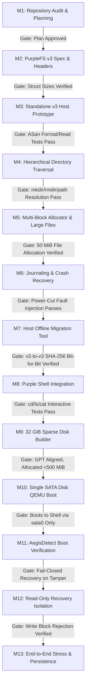

# Purple OS / Aegis64 — Full System Architecture and Bootable SATA Image Architecture Plan (Corrected & Reviewed)

**Document:** `docs/PURPLE_OS_BOOTABLE_IMAGE_ARCHITECTURE_PLAN.md`  
**Classification:** Engineering Architecture & Staged Implementation Plan (Planning Only)  
**Target Repository:** `/home/saptanshu-ganguly/OS`  
**Target Branch:** `Aegis_Purple`  
**Kernel:** Aegis64 Monolithic Kernel (`src/kernel/main.c`, `src/kernel/boot.S`)  
**Subsystems:** AegisSched, AegisDetect, PurpleDetect, APDRV, Unified Storage Layer, GPT, PurpleFS  
**Date:** 2026-10-22  
**Status:** PROPOSED & CORRECTED — AWAITING HUMAN REVIEW & USER APPROVAL (Zero implementation modifications)

---

## 1. Verified Repository Baseline & Ground Truth

### 1.1 Working Tree & Git State Confirmation

A comprehensive inspection of the working tree using non-paging Git checks (`git --no-pager status --short --branch`, `git --no-pager diff --stat`, and `git --no-pager log -1 --oneline`) established the exact repository state:

- **Active Branch:** `Aegis_Purple` (synchronous with `origin/Aegis_Purple`).
- **Latest Commit:** `409c0cd` ("Purple OS: Shell Path Normalization Implementation and Unit Tests").
- **Working Tree State:** **Uncommitted local modifications exist and are strictly preserved.** (The working tree is NOT clean):
  - `Makefile`: Shell path normalization targets.
  - `include/shell.h`: Path normalization helper function declarations.
  - `src/kernel/shell.c`: Shell-side path normalization logic for root-level files.
  - `scripts/test_qemu_storage.py`: Storage test runner.
  - `tests/test_purplefs_v2.c`: Expanded PurpleFS v2 unit test fixtures.
- **Tracked Checkpoints:**
  - `checkpoints/20261022-shell-path-normalization/`: Contains historical pre-normalization files and `MANIFEST.txt`.
  - `checkpoints/20261022-architecture-plan-review/`: Created before editing this document; archives baseline Git status and the initial plan draft (`PURPLE_OS_BOOTABLE_IMAGE_ARCHITECTURE_PLAN.initial.md`).
- **Untracked Audit Evidence:**
  - `docs/CHECKPOINT_20261022_PURPLEFS_AUDIT.md`: Pre-audit state record.
  - `docs/PURPLEFS_VERIFICATION_AUDIT_REPORT.md`: Filesystem verification audit.
  - `scripts/test_qemu_persistence.py`: Cold-reboot test script.
  - `tests/test_shell_path.c`: Unit tests for path normalization.

### 1.2 Inspection of Existing Subsystems & Code Verification

| Subsystem | Verified Source Locations | Actual Verified Implementation & Limitations |
| :--- | :--- | :--- |
| **Boot Protocol** | `src/kernel/boot.S`<br>`src/kernel/main.c` | Multiboot 1 entry in 32-bit protected mode (`_start`). Builds identity page tables (4 GiB via 2 MiB huge pages), sets PAE/SSE in CR4, enables Long Mode (EFER.LME) and NXE, loads 64-bit GDT, jumps to `kernel_main_64(mbi, magic)`. Framebuffer initialized via VBE/GOP info in Multiboot struct (`video_init`). |
| **Storage Architecture** | `src/kernel/storage.c`<br>`src/drivers/storage/ahci.c`<br>`src/drivers/storage/ata_pio.c` | Unified block device layer (`block_dev_t`). Scans 4 legacy ATA channels, then scans AHCI PCIe controllers (`ahci_init()`), then NVMe controllers (`nvme_init()`). Registers `sata0`..`sataN`. Parses GPT partitions on all detected block devices. **Monolithic built-in:** AHCI and ATA drivers are compiled directly into the kernel, not dynamically loaded. |
| **GPT Parsing** | `src/fs/gpt.c`<br>`include/gpt.h` | LBA 1 Primary GPT Header, LBA 2..33 Partition Array (128 entries of 128 bytes). CRC32 header and partition array verification. Recognizes `GPT_GUID_ESP` (`C12A7328-F81F-11D2-BA4B-00A0C93EC93B`) and `GPT_GUID_PURPLEFS_V2` (`4F535046-5332-0001-8000-00A0C911D504`). |
| **PurpleFS v2 Limits** | `src/fs/purplefs_v2.c`<br>`include/fs/purplefs_v2.h` | Magic `0x50555250` (`"PURP"`). 4 KiB block size. Dedicated Block 1 bitmap (32,768 bits) caps volume at 128 MiB. Dedicated Block 10 root directory table caps total files at 128. Inodes have 12 direct + 1 indirect block (max 1036 blocks = 4.047 MiB); double indirect returns `PFS2_ERR_TOO_BIG`. No subdirectories, no `mkdir`, no atomic rename/unlink. |
| **Driver Framework** | `src/drivers/apdrv.c`<br>`include/apdrv.h` | Version 3 `.apdrv` format (`APDRV100`). Relocatable ELF-like sections (`.text`, `.rodata`, `.data`, `.bss`). W^X page protection enforced via VMM. Kernel symbol resolution via `ksym.c`. Loaded dynamically *after* storage and filesystem are mounted. |
| **Integrity Protection** | `src/security/aegis_detect.c`<br>`include/security/aegis_detect.h` | HMAC-SHA256 authenticated manifest parser. Built-in hardcoded 32-byte key (`default_trust_key`). Component flags (`AEGIS_FLAG_CRITICAL`, `AEGIS_FLAG_SYSTEM`, `AEGIS_FLAG_OPTIONAL`). Fail-closed alert banner on critical tamper. |

---

## 2. PurpleFS Compatibility & Versioning Strategy

### 2.1 Formal Proof of PurpleFS v2 Limits

Verification against `include/fs/purplefs_v2.h` confirms mathematical limits that preclude hierarchical 32 GiB deployments:
1. **128 MiB Maximum Capacity:**  
   $$\text{Block Bitmap Capacity} = 4096\text{ bytes} \times 8\text{ bits/byte} = 32,768\text{ blocks}$$
   $$\text{Max Volume Size} = 32,768 \times 4096\text{ bytes} = 134,217,728\text{ bytes} = 128\text{ MiB}$$
   A 29.5 GiB partition contains $7,732,736$ blocks (requiring 236 bitmap blocks). Attempting to format or mount a 29.5 GiB partition under v2 leads to silent truncation or out-of-bounds corruption.
2. **Fixed 128 Root Entries:**  
   The root directory table is a single 4096-byte block at LBA 10 composed of 128 entries of 32 bytes (`pfs2_dir_entry_t`). There is no mechanism to allocate additional directory blocks.
3. **No Nested Directory Inodes:**  
   `pfs2_lookup` scans only Block 10. `pfs2_dir_entry_t.name` is 24 bytes (max 23 characters). A path like `System/Drivers/storage_ahci.apdrv` (33 characters) exceeds the buffer, and directories cannot be opened or traversed.
4. **File Size Capped at 4.047 MiB:**  
   The inode structure defines `direct_blocks[12]` and `indirect_block` (1024 pointers).
   $$\text{Max File Blocks} = 12 + 1024 = 1036\text{ blocks} = 4,243,456\text{ bytes} \approx 4.047\text{ MiB}$$
   `pfs2_write_file` explicitly returns `PFS2_ERR_TOO_BIG` if an offset exceeds 1036 blocks. Large application binaries or recovery images cannot be stored.

### 2.2 Preservation of PurpleFS v2 & Clean Separation of v3

- **PurpleFS v2 Unchanged:** `src/fs/purplefs_v2.c` and `include/fs/purplefs_v2.h` remain completely untouched to preserve backward compatibility with all historical tests, checkpoints, and documentation.
- **Distinct PurpleFS v3 Format:** PurpleFS v3 will be implemented in dedicated new files (`src/fs/purplefs_v3.c` and `include/fs/purplefs_v3.h`) with distinct identifiers:
  - Magic: `0x50465333` (`"PFS3"`), Version `3`.
  - GPT System Partition GUID: `4F535046-5333-0001-8000-00A0C911D504` (`GPT_GUID_PURPLEFS_V3`).
  - GPT Recovery Partition GUID: `4F535046-5352-0001-8000-00A0C911D504` (`GPT_GUID_PURPLEFS_RECOVERY`).
- **Compatibility Behavior:** The kernel storage discovery checks partition GUIDs and superblock magic:
  - Partitions with `GPT_GUID_PURPLEFS_V2` invoke `pfs2_mount` in read-only legacy mode.
  - Partitions with `GPT_GUID_PURPLEFS_V3` invoke `pfs3_mount` with full hierarchical read-write capabilities.
  - No automatic in-place modification or conversion is ever performed by the kernel.

---

## 3. 32 GiB UEFI GPT Layout & Precise LBA Arithmetic

### 3.1 Exact Sector Math & Alignment

A 32 GiB disk with 512-byte sectors has:
$$\text{Total Capacity} = 32 \times 1024 \times 1024 \times 1024\text{ bytes} = 34,359,738,368\text{ bytes}$$
$$\text{Total Sectors} = \frac{34,359,738,368}{512} = 67,108,864\text{ sectors}$$
$$\text{LBA Range} = \text{LBA } 0 \text{ to LBA } 67,108,863$$

#### GPT Structural Regions:
- **LBA 0:** Protective MBR (1 sector).
- **LBA 1:** Primary GPT Header (`MyLBA = 1`, `AlternateLBA = 67,108,863`, `FirstUsableLBA = 34`, `LastUsableLBA = 67,108,830`).
- **LBA 2..33:** Primary Partition Array (128 entries $\times$ 128 bytes = 16,384 bytes = 32 sectors).
- **LBA 34..2047:** Alignment Padding (2014 sectors = 1007 KiB) to align Partition 1 to the standard 1 MiB boundary ($2048 \times 512 = 1,048,576\text{ bytes}$).
- **LBA 67,106,816..67,108,830:** Trailing Alignment Padding (2015 sectors = ~1007.5 KiB) ensuring Partition 3 ends on a 1 MiB boundary while remaining $\le \text{LastUsableLBA}$.
- **LBA 67,108,831..67,108,862:** Backup Partition Array (32 sectors).
- **LBA 67,108,863:** Backup GPT Header (1 sector).

### 3.2 Partition Boundaries (Strict 1 MiB Alignment)

Every partition starts and ends on an exact 1 MiB boundary (multiples of 2048 sectors) and is an exact integer multiple of 4 KiB filesystem blocks (8 sectors per block):

```
====================================================================================================
LBA 0                          : Protective MBR (Type 0xEE)
LBA 1                          : Primary GPT Header
LBA 2..33                      : Primary Partition Table Array (128 entries * 128 bytes)
LBA 34..2047                   : Alignment Padding (to 1 MiB)
====================================================================================================
PARTITION 1: EFI System Partition (ESP) [FAT32]
  Start LBA                    : 2,048 (1 MiB boundary)
  End LBA                      : 1,050,623
  Sector Count                 : 1,048,576 sectors (exactly 512 MiB = 0.50 GiB)
  4 KiB Block Count            : 131,072 blocks (8 sectors/block)
  Partition Type GUID          : C12A7328-F81F-11D2-BA4B-00A0C93EC93B
  Role                         : UEFI boot binaries, GRUB/AegisBootloader, kernel ELF, boot config.
----------------------------------------------------------------------------------------------------
PARTITION 2: PurpleSystem (Root '/') [PurpleFS v3]
  Start LBA                    : 1,050,624 (513 MiB boundary)
  End LBA                      : 62,912,511
  Sector Count                 : 61,861,888 sectors (exactly 30,206 MiB = 29.50 GiB)
  4 KiB Block Count            : 7,732,736 blocks (8 sectors/block)
  Partition Type GUID          : 4F535046-5333-0001-8000-00A0C911D504
  Role                         : Full directory hierarchy (/System, /Boot, /Applications, /Users).
----------------------------------------------------------------------------------------------------
PARTITION 3: PurpleRecovery ('/Recovery') [PurpleFS v3 - Read-Only]
  Start LBA                    : 62,912,512 (30,719 MiB boundary)
  End LBA                      : 67,106,815
  Sector Count                 : 4,194,304 sectors (exactly 2,048 MiB = 2.00 GiB)
  4 KiB Block Count            : 524,288 blocks (8 sectors/block)
  Partition Type GUID          : 4F535046-5352-0001-8000-00A0C911D504
  Role                         : Pristine emergency kernel, recovery tools, golden restore images.
====================================================================================================
LBA 67,106,816 .. 67,108,830  : Trailing Alignment Padding (2,015 sectors)
LBA 67,108,831 .. 67,108,862  : Backup Partition Table Array (32 sectors)
LBA 67,108,863                 : Backup GPT Header (Last LBA of disk)
====================================================================================================
```

*Verification:*
$$\text{Start LBA } 2048 \ge \text{FirstUsableLBA } 34$$
$$\text{End LBA } 67,106,815 \le \text{LastUsableLBA } 67,108,830$$
All partitions lie strictly within the usable LBA window with zero overlap and zero fractional blocks.

---

## 4. Hierarchical PurpleFS v3 On-Disk Specification

### 4.1 Inode Structure Size Correction (Exactly 128 Bytes)

The previous draft had a 124-byte layout. The corrected `pfs3_inode_t` layout totals **exactly 128 bytes** (yielding exactly $4096 / 128 = 32\text{ inodes}$ per 4 KiB block with zero alignment waste):

```c
typedef struct {
    uint16_t mode;                      /* 0x00: File type (DIR, REG, SYMLINK) & POSIX permissions */
    uint16_t uid;                       /* 0x02: Owner User ID */
    uint16_t gid;                       /* 0x04: Owner Group ID */
    uint16_t links_count;               /* 0x06: Hard link counter */
    uint32_t flags;                     /* 0x08: Immutability, system, quarantine flags */
    uint64_t size_bytes;                /* 0x0C: 64-bit file size in bytes */
    uint64_t atime;                     /* 0x14: Last access timestamp (POSIX seconds) */
    uint64_t mtime;                     /* 0x1C: Last modification timestamp */
    uint64_t ctime;                     /* 0x24: Status change timestamp */
    uint32_t generation;                /* 0x2C: Inode generation/version counter */
    
    /* Block Addressing (4-byte block pointers) */
    uint32_t direct[12];                /* 0x30: 12 direct blocks (12 * 4 KiB = 48 KiB) */
    uint32_t indirect;                  /* 0x60: Single indirect (1024 pointers * 4 KiB = 4 MiB) */
    uint32_t double_indirect;           /* 0x64: Double indirect (1024^2 * 4 KiB = 4 GiB) */
    uint32_t triple_indirect;           /* 0x68: Triple indirect (1024^3 * 4 KiB = 4 TiB) */
    
    uint32_t checksum;                  /* 0x6C: CRC32 of inode metadata (bytes 0x00..0x6B) */
    uint8_t  reserved[16];              /* 0x70: Reserved for expansion (pad to exactly 128 bytes) */
} __attribute__((packed)) pfs3_inode_t;
```

**Offset Verification:**
- Headers & Timestamps: $2 + 2 + 2 + 2 + 4 + 8 + 8 + 8 + 8 + 4 = 48\text{ bytes}$ (Offset `0x00`..`0x2F`).
- Addressing: $12 \times 4 + 4 + 4 + 4 = 60\text{ bytes}$ (Offset `0x30`..`0x6B`).
- Checksum: $4\text{ bytes}$ (Offset `0x6C`..`0x6F`).
- Reserved: $16\text{ bytes}$ (Offset `0x70`..`0x7F`).
- **Total:** $48 + 60 + 4 + 16 = 128\text{ bytes}$.

### 4.2 Reconciled Directory Structure (Structured Fixed 64-Byte Records)

To reconcile the ambiguity between variable-length records and fixed-record tables, PurpleFS v3 adopts **Structured Fixed-Record Directory Blocks** (64 bytes per entry, 64 entries per 4 KiB block):

```c
typedef struct {
    uint32_t inode_num;                 /* Target inode number (0 = deleted/free slot) */
    uint8_t  file_type;                 /* 1=Regular, 2=Directory, 3=Symlink, 4=Device */
    uint8_t  name_len;                  /* Actual length of name string (1..55) */
    uint16_t reserved;                  /* Alignment pad */
    char     name[56];                  /* Null-terminated name (up to 55 chars) */
} __attribute__((packed)) pfs3_dirent_t;
```

**Architectural Advantages:**
1. Exactly $4096 / 64 = 64\text{ entries}$ fit in one 4 KiB data block, completely eliminating internal fragmentation.
2. Direct index-based slot arithmetic: $\text{slot\_offset} = \text{index} \times 64$.
3. File deletion is an atomic write: setting `inode_num = 0` instantly marks the slot free without requiring complex heap defragmentation.
4. Scale-Out: When a directory exceeds 64 entries, a new 4 KiB block is allocated through the directory inode's block list, scaling seamlessly to thousands of files.
5. Invariant entries: Every directory's first data block has Slot 0 as `.` (pointing to self inode) and Slot 1 as `..` (pointing to parent directory inode; in Root inode 2, `..` points to 2).

---

## 5. Non-Circular Boot Chain & Driver Dependency Architecture

### 5.1 Eliminating the Circular Storage Dependency

A fatal design flaw in modular OS architectures is attempting to load the primary disk driver from the filesystem that the disk driver is required to access. Purple OS resolves this through a strictly non-circular layered architecture:

```
+----------------------------------------------------------------------------------------------------+
| LAYER 0: UEFI Firmware (OVMF)                                                                      |
| Reads Partition 1 (FAT32 ESP). Loads /EFI/BOOT/BOOTX64.EFI.                                       |
+----------------------------------------------------------------------------------------------------+
                                                │
                                                ▼
+----------------------------------------------------------------------------------------------------+
| LAYER 1: Bootloader Handoff (GRUB / AegisBootloader)                                               |
| Reads /EFI/BOOT/KERNEL.ELF into RAM. Prepares Multiboot info & memory map. Jumps to _start.        |
+----------------------------------------------------------------------------------------------------+
                                                │
                                                ▼
+----------------------------------------------------------------------------------------------------+
| LAYER 2: Monolithic Core Storage Engine (Built-in to aegis64.elf)                                  |
| Initialized directly in C code (kernel_main_64):                                                   |
| - PCI Bus Enumeration (pci.c)                                                                      |
| - AHCI / SATA Controller Driver (ahci.c)                                                           |
| - GPT Partition Parser (gpt.c) & Partition Device Layer (partition_dev.c)                          |
| - PurpleFS v3 Core Reader (purplefs_v3.c)                                                          |
| Mounts Partition 2 (PurpleSystem) at root ('/') using built-in in-kernel drivers.                  |
+----------------------------------------------------------------------------------------------------+
                                                │
                                                ▼
+----------------------------------------------------------------------------------------------------+
| LAYER 3: Cryptographic Integrity Verification (AegisDetect)                                        |
| Kernel reads /System/manifest.aegis from mounted Partition 2.                                      |
| Authenticates manifest against embedded trust anchor.                                              |
| Verifies SHA-256 hashes of secondary modules before execution.                                     |
+----------------------------------------------------------------------------------------------------+
                                                │
                                                ▼
+----------------------------------------------------------------------------------------------------+
| LAYER 4: Dynamic Peripheral Driver Loading (APDRV Subsystem)                                       |
| Loads non-critical peripheral drivers from /System/Drivers/:                                       |
| - Audio (ac97.apdrv), Network (e1000.apdrv), USB HID (usb_hid.apdrv)                               |
| Applies relocations and sets W^X page permissions before running module init.                     |
+----------------------------------------------------------------------------------------------------+
```

### 5.2 Component Classification & Fail-Closed Enforcement

Boot components are strictly categorized in `/System/manifest.aegis`:

```
Manifest Verification Flow:
    ├── Entry: /System/Kernel/aegis64.elf   [AEGIS_FLAG_CRITICAL] -> Mismatch: ABORT BOOT -> RECOVERY
    ├── Entry: /System/manifest.aegis       [AEGIS_FLAG_CRITICAL] -> Mismatch: ABORT BOOT -> RECOVERY
    ├── Entry: /System/Libraries/libc.so    [AEGIS_FLAG_SYSTEM]   -> Mismatch: ABORT BOOT -> RECOVERY
    ├── Entry: /System/Drivers/ac97.apdrv   [AEGIS_FLAG_OPTIONAL] -> Mismatch: QUARANTINE -> CONTINUE
    └── Entry: /System/Drivers/e1000.apdrv  [AEGIS_FLAG_OPTIONAL] -> Mismatch: QUARANTINE -> CONTINUE
```

- **Missing/Tampered Critical Component:** Enforces a **Fail-Closed policy**: normal user space is never executed; a red security alert displays on the video console; the kernel immediately unmounts `/System` and boots into the Recovery partition.
- **Missing/Tampered Optional Driver:** Logs a warning message, sets driver state to `APDRV_STATE_ERROR`, quarantines the module, and allows normal system boot to proceed.

---

## 6. Recovery Architecture & Public-Key Security Model

### 6.1 Booting When Primary Partition is Corrupted

UEFI firmware cannot read PurpleFS v3. If Partition 2 (`PurpleSystem`) suffers catastrophic metadata corruption or disk error:
1. UEFI boots normally from **Partition 1 (ESP)**, which is standard FAT32.
2. The bootloader menu offers:
   - `Purple OS (Normal Boot)`: `root=UUID=<PurpleSystem-UUID>`
   - `Purple OS Recovery Mode`: `root=UUID=<PurpleRecovery-UUID> recovery=1`
3. If normal boot is selected but the kernel detects unmountable metadata or critical tamper on Partition 2, the built-in storage engine automatically falls back to mounting Partition 3 (`PurpleRecovery`) as the emergency root.
4. Partition 3 contains an independent, clean PurpleFS v3 filesystem with emergency diagnostic tools, an offline restore utility, and a verified golden image.

### 6.2 Security Model Review: Symmetric HMAC vs. Asymmetric Public-Key Signatures

- **Limitations of Embedded HMAC:**  
  The current implementation in `src/security/aegis_detect.c` uses a shared symmetric secret (`default_trust_key`). Because this key is compiled into the kernel binary, an attacker with read access to the image can extract the key and forge HMAC tags for tampered binaries. Embedded HMAC protects against accidental corruption, runtime memory faults, or unprivileged local tampering, but **does not provide tamper resistance against an attacker with offline disk write access**.
- **Asymmetric Signature Architecture (Milestone 11 Target):**  
  Purple OS will transition manifest verification to **Ed25519 / RSA-2048 public-key cryptography**:
  - The **Private Signing Key** remains strictly off-device in the development/release build environment.
  - The **Public Verification Key** is embedded in the kernel's read-only memory (`.rodata`).
  - Offline attackers cannot forge signatures for modified files without possessing the private key.
- **Clarification on UEFI Secure Boot:**  
  Standard OVMF in development mode does not enforce Secure Boot unless custom platform keys (PK, KEK, db) are enrolled into `OVMF_VARS.fd`. We do not claim UEFI Secure Boot is active until key enrollment and EFI binary signing are explicitly integrated.

### 6.3 Block-Device Write Boundary Protection for Recovery

Partition 3 (`PurpleRecovery`) is write-protected at the kernel driver boundary:
- In `src/fs/partition_dev.c`, Partition 3 is initialized with `read_only = 1`.
- Any write request targeting Partition 3 LBAs is intercepted and rejected with `BLOCK_DEV_ERR_RO` before reaching the AHCI controller.
- **Authenticated Update-Unlock Protocol:**
  1. An update package (`update.pkg`) is verified in host RAM via public-key signature.
  2. The kernel verifies the signature and issues an atomic one-time unlock token.
  3. The administrator invokes `storage_unlock_recovery(token)`.
  4. The driver temporarily clears `read_only = 0` and arms a 30-second hardware watchdog timer.
  5. The updater writes the new recovery blocks.
  6. The updater immediately calls `storage_lock_recovery()`, which flushes the controller cache via `ahci_bdev_flush` and relocks `read_only = 1`.

---

## 7. Safe Sparse Disk Creation & Validation Process

To prevent host disk exhaustion and avoid overwriting existing data, `scripts/build_sata_disk.py` follows strict safety rules:

1. **No Accidental Overwrite:** If the destination file exists, the script halts with an error unless `--force` is explicitly provided.
2. **Sparse Allocation:** The 32 GiB image is created using sparse file seeking rather than allocating contiguous bytes:
   ```python
   with open(output_path, "wb") as f:
       f.seek(32 * 1024 * 1024 * 1024 - 1)
       f.write(b"\0")
   ```
3. **Host Storage Allocation Assertion:**  
   After writing the GPT headers, ESP FAT32 content, and PurpleFS initial metadata, the script queries actual allocated blocks via `os.stat(output_path).st_blocks * 512`.  
   It asserts:
   $$\text{Actual Allocated Disk Space} \le 500\text{ MiB}$$
   If actual allocation exceeds 1 GiB, the script aborts immediately to protect host storage.

---

## 8. Revised 13-Milestone Roadmap with Explicit Acceptance Gates

Every milestone is gated: **no milestone may begin until the preceding milestone passes its acceptance criteria and verification tests.**



---

### Milestone 1 — Repository Baseline & Planning (COMPLETED)
- **Files Changed:** None (Produced `docs/PURPLE_OS_BOOTABLE_IMAGE_ARCHITECTURE_PLAN.md`).
- **Dependencies:** None.
- **Acceptance Gate:** Plan mathematically verified, working tree preserved, zero code modifications.
- **Rollback:** N/A.

### Milestone 2 — PurpleFS v3 Header Definitions & Structure Alignment
- **Files to Change:** `include/fs/purplefs_v3.h`, `include/gpt.h`, `tests/test_pfs3_structs.c`.
- **Dependencies:** Milestone 1 approval.
- **Acceptance Gate:** Host compilation test verifies `sizeof(pfs3_superblock_t) == 128`, `sizeof(pfs3_inode_t) == 128`, `sizeof(pfs3_dirent_t) == 64` with zero structure padding warnings.
- **Rollback:** Remove created header and test file.

### Milestone 3 — Standalone PurpleFS v3 Host Prototype & Unit Tests
- **Files to Change:** `src/fs/purplefs_v3.c`, `tests/test_purplefs_v3_core.c`, `Makefile`.
- **Dependencies:** Milestone 2.
- **Acceptance Gate:** Host test formats in-memory volume, writes/reads inodes and blocks, passes under GCC AddressSanitizer (ASan) and UndefinedBehaviorSanitizer (UBSan).
- **Rollback:** Revert additions to `purplefs_v3.c` and `Makefile`.

### Milestone 4 — Hierarchical Directory & Path Resolution APIs
- **Files to Change:** `src/fs/purplefs_v3.c`, `include/fs/purplefs_v3.h`, `tests/test_pfs3_dirs.c`.
- **Dependencies:** Milestone 3.
- **Acceptance Gate:** Creation and traversal of nested paths (`/System/Kernel/aegis64.elf`), resolution of `.` and `..`, rejection of circular paths and paths >32 levels deep.
- **Rollback:** Revert directory functions in `purplefs_v3.c`.

### Milestone 5 — Scalable Multi-Block Allocator & Large-File Addressing
- **Files to Change:** `src/fs/purplefs_v3.c`, `tests/test_pfs3_largefile.c`.
- **Dependencies:** Milestone 4.
- **Acceptance Gate:** Allocation, writing, and SHA-256 read-back verification of a 50 MiB file spanning >12,800 blocks across multi-block allocation bitmaps without memory leaks.
- **Rollback:** Revert allocator additions.

### Milestone 6 — Transactional Metadata Journaling & Crash Recovery
- **Files to Change:** `src/fs/purplefs_v3.c`, `tests/test_pfs3_journal.c`.
- **Dependencies:** Milestone 5.
- **Acceptance Gate:** Fault injection harness simulates sudden process abort mid-write; journal replay restores filesystem to consistent state without orphaned blocks.
- **Rollback:** Revert journal functions.

### Milestone 7 — Safe Host Migration Utility (`pfs2_to_pfs3.py`)
- **Files to Change:** `scripts/pfs2_to_pfs3.py`, `tests/test_pfs_migration.py`.
- **Dependencies:** Milestones 2–5.
- **Acceptance Gate:** Non-destructively reads v2 images, creates v3 volume, migrates files into `/System` hierarchy, verifies exact SHA-256 match; leaves source v2 file bit-for-bit unchanged.
- **Rollback:** Remove migration script.

### Milestone 8 — Purple Shell Directory Command Integration
- **Files to Change:** `src/kernel/shell.c`, `include/shell.h`, `tests/test_shell_v3.c`.
- **Dependencies:** Milestone 4.
- **Acceptance Gate:** Host test harness validates interactive commands (`cd /System`, `ls`, `mkdir`, `peek`, `write`, `rm`) with full path navigation.
- **Rollback:** Restore pre-existing `shell.c` from checkpoint.

### Milestone 9 — 32 GiB Sparse Disk Builder & ESP Packaging
- **Files to Change:** `scripts/build_sata_disk.py`, `Makefile`.
- **Dependencies:** Milestones 2, 7.
- **Acceptance Gate:** Generates 32 GiB sparse image with FAT32 ESP, PurpleSystem, and PurpleRecovery partitions; actual host disk allocation $\le 500\text{ MiB}$; GPT verified with 1 MiB alignment.
- **Rollback:** Remove build script.

### Milestone 10 — Single Virtual SATA Disk QEMU AHCI Boot
- **Files to Change:** `src/kernel/storage.c`, `src/kernel/main.c`, `scripts/run_uefi_sata.sh`.
- **Dependencies:** Milestone 9.
- **Acceptance Gate:** Purple OS boots under QEMU UEFI exclusively from `sata0` without `-kernel` or auxiliary drives; mounts `PurpleSystem` at `/`; reaches AegisShell prompt.
- **Rollback:** Revert storage mount changes.

### Milestone 11 — AegisDetect Boot Verification & Fail-Closed Enforcement
- **Files to Change:** `src/security/aegis_detect.c`, `src/drivers/apdrv.c`, `src/kernel/main.c`.
- **Dependencies:** Milestone 10.
- **Acceptance Gate:** Deliberate modification of `aegis64.elf` halts normal boot and redirects to Recovery; deliberate modification of `ac97.apdrv` logs warning and continues normal boot.
- **Rollback:** Revert verification hooks.

### Milestone 12 — Read-Only Recovery Partition Isolation & Updates
- **Files to Change:** `src/fs/partition_dev.c`, `src/kernel/storage.c`, `src/kernel/shell.c`.
- **Dependencies:** Milestones 10, 11.
- **Acceptance Gate:** Normal shell commands cannot write to `/Recovery` (`BLOCK_DEV_ERR_RO`); authenticated unlock procedure allows temporary update and immediately relocks.
- **Rollback:** Revert write-protection logic.

### Milestone 13 — End-to-End Stress & Cold-Reboot Persistence Suite
- **Files to Change:** `scripts/test_full_system.py`, documentation.
- **Dependencies:** Milestones 1–12.
- **Acceptance Gate:** 50 automated QEMU cold-reboots with random power cuts during writes; 100% journal recovery rate; zero data corruption; all test suites pass.
- **Rollback:** Archive final milestone checkpoint.

---

## 9. Deliverables & Safety Compliance Record

- **Working Directory:** `/home/saptanshu-ganguly/OS`
- **Active Branch:** `Aegis_Purple`
- **Source Code Modified:** Zero lines (Only documentation and checkpoint files created).
- **Checkpoints Created:**
  - `checkpoints/20261022-architecture-plan-review/` containing `MANIFEST.txt` and `PURPLE_OS_BOOTABLE_IMAGE_ARCHITECTURE_PLAN.initial.md`.
- **Working Tree Status:** Preserved with existing uncommitted changes intact.
